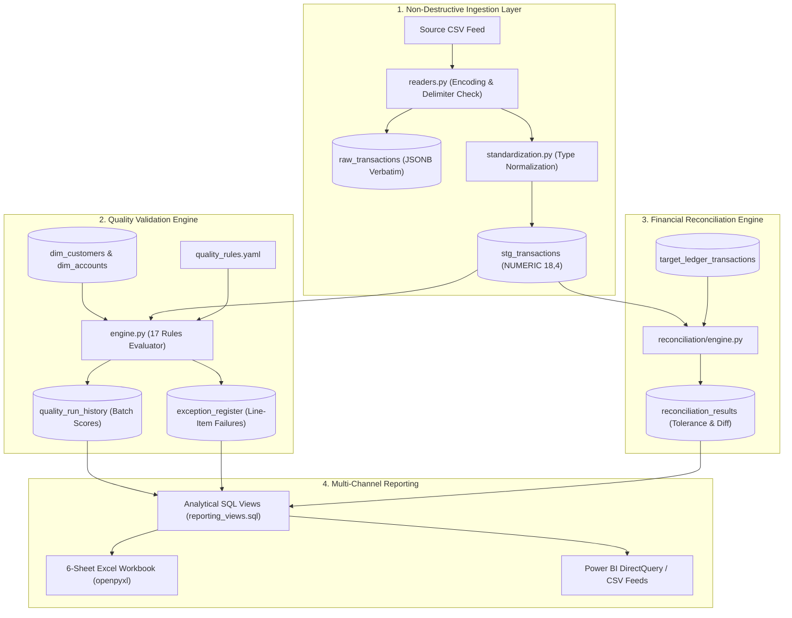
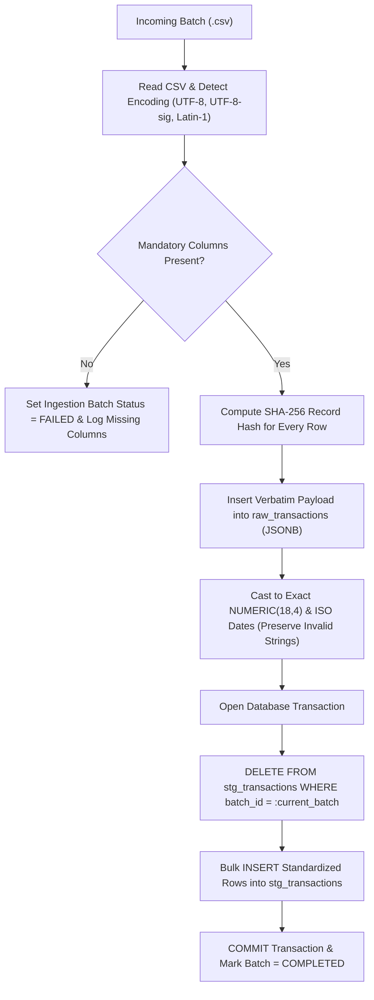
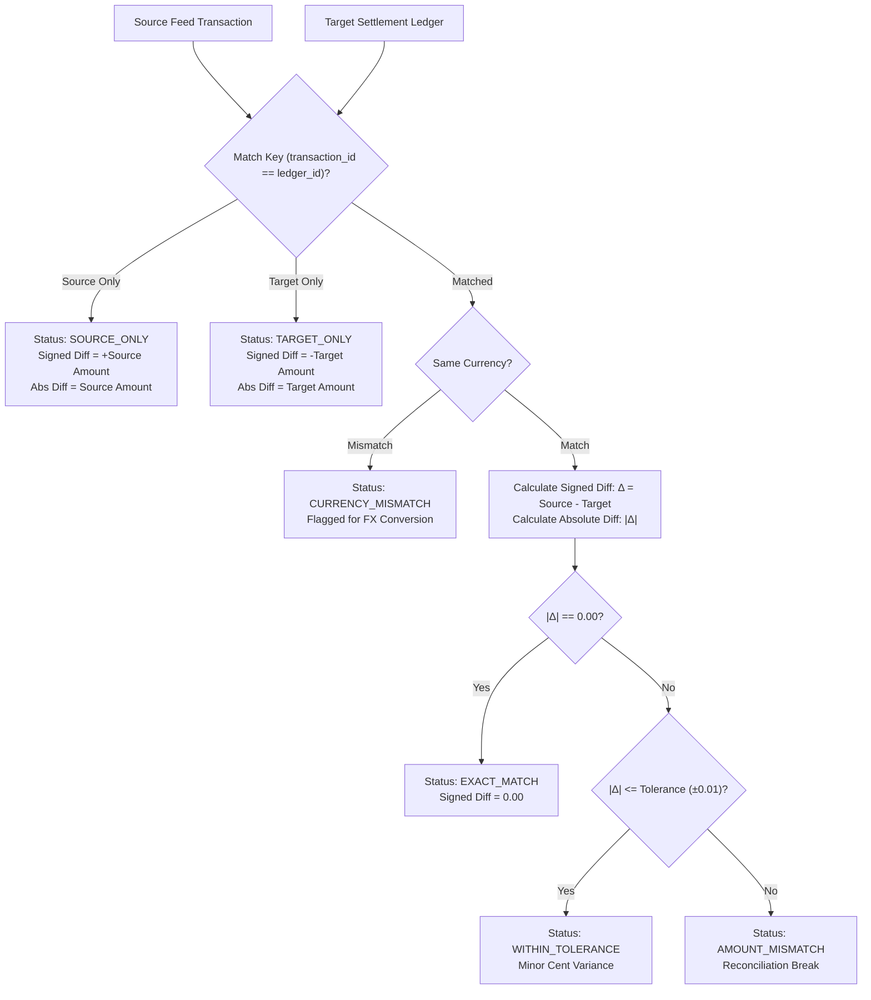
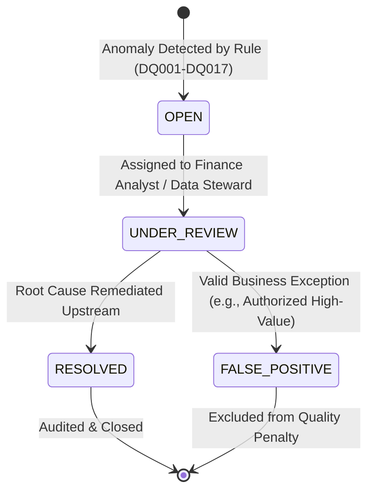

# DataGuard
## Financial Data Quality & Transaction Monitoring System
*Production-Quality | GitHub-Ready | Interview-Defensible*

[](https://github.com/DataGuard/dataguard/actions/workflows/tests.yml)
[](LICENSE)
[](https://www.python.org/)
[](https://www.postgresql.org/)

---

## 1. Project Overview

**DataGuard** is an end-to-end financial data quality and transaction monitoring system designed to validate transaction records using Python and SQL, detect data anomalies, reconcile financial totals against settlement ledgers, maintain an auditable exception register, and communicate data quality performance through Power BI dashboards and Excel workbooks.

Unlike isolated data-cleaning scripts or static dashboards, DataGuard connects every component—from raw CSV ingestion and non-destructive JSONB preservation to SQL window-function deduplication, exact decimal reconciliation, and openpyxl reporting—into one traceable, reproducible pipeline.

---

## 2. Business Problem & Solution

### The Challenge
In modern financial institutions, transaction feeds from payment gateways, core banking, and external clearinghouses frequently suffer from data quality issues:
- Dropped identifier columns or blank account keys.
- Duplicate transaction ingestion from upstream retry loops.
- Sign discrepancies (e.g. negative deposits) and fractional-cent rounding leaks.
- Timing mismatches and date clock skews.
- Ledger imbalances between transaction feeds and settlement ledgers.

If undetected, these errors distort financial reporting, breach regulatory compliance, and require costly manual reconciliation.

### The DataGuard Solution
DataGuard establishes an automated quality firewall:
1. **Raw Preservation:** Preserves original source records verbatim as JSONB before transformation.
2. **Deterministic Rules Engine:** Evaluates 17 documented rules (`DQ001`–`DQ017`) across Completeness, Validity, Uniqueness, Timeliness, Integrity, and Consistency.
3. **Auditable Exception Register:** Logs every failure with record references, severity, offending values, and lifecycle tracking (`OPEN` → `UNDER_REVIEW` → `RESOLVED`).
4. **Financial Reconciliation Engine:** Compares transaction feeds against settlement ledgers with strict multi-currency isolation and configurable tolerance ($\pm 0.01$).
5. **Business Reporting:** Produces a 6-sheet Excel report and Power BI dimensional views.

---

## 3. System Architecture & Detailed Flowcharts


### 3.1 End-to-End Pipeline Architecture



---

### 3.2 Ingestion & Idempotency Pipeline Flowchart



---

### 3.3 Financial Reconciliation Matching Logic Flowchart



---

### 3.4 Exception Lifecycle State Machine



---

## 4. Technology Stack & Database Architecture

### 4.1 Technology Stack

| Component | Technology | Version | Responsibility |
|---|---|---|---|
| **Programming Language** | Python | `3.14.7` | Pipeline orchestration, data validation, and CLI |
| **Data Processing** | pandas, NumPy | `3.0.6`, `2.5.4` | High-performance vectorized checks and transformation |
| **Relational Database** | PostgreSQL | `18.0` (x64) | Persistent storage, ACID transactions, exact numeric types |
| **Query Language** | SQL (PostgreSQL Dialect) | ANSI / PG 18 | Window functions, CTEs, referential integrity joins, views |
| **Database Access** | SQLAlchemy, psycopg2 | `2.1.4`, `2.9.13` | Connection pooling, parameterized queries, migrations |
| **Testing Framework** | Pytest | `8.4.2` | Unit tests, integration tests, and ground-truth regression tests |
| **Excel Reporting** | openpyxl | `3.1.5` | Automated 6-sheet corporate financial workbook generation |
| **Business Intelligence** | Power BI Desktop | DirectQuery / CSV | Interactive 3-page executive and operational dashboard |
| **Containerization** | Docker, Docker Compose | `29.7.2`, `5.5.1` | Containerized local execution and automated CI |
| **Continuous Integration** | GitHub Actions | Ubuntu Latest | Automated build, schema initialization, and test verification |

---

### 4.2 Database Tables & Storage Inventory (Actual Database Counts)

| Table Name | Schema Role | Primary Key | Foreign Key Dependencies | Constraints | Actual Records |
|---|---|---|---|---|---|
| **`ingestion_batches`** | Batch Metadata | `batch_id` | None | `status IN ('STARTED','COMPLETED','FAILED')` | 6 |
| **`raw_transactions`** | Raw Preservation | `raw_id` | `batch_id → ingestion_batches` | `ON DELETE CASCADE`, `JSONB` Payload | 1,106 |
| **`dim_customers`** | Reference Dimension | `customer_id` | None | `customer_type IN ('INDIVIDUAL','CORPORATE')` | 50 |
| **`dim_accounts`** | Reference Dimension | `account_id` | `customer_id → dim_customers` | `status IN ('ACTIVE','DORMANT','CLOSED')` | 100 |
| **`stg_transactions`** | Staging Ledger | `staging_id` | `batch_id → ingestion_batches` | `NUMERIC(18,4)`, Indexed `record_hash` | 1,109 |
| **`quality_rules`** | Rule Metadata | `rule_id` | None | Dimension & Severity Enums | 17 |
| **`quality_run_history`** | Quality Snapshots | `run_id` | `batch_id → ingestion_batches` | Dimensional scores `NUMERIC(5,2)` | 5 |
| **`exception_register`** | Traceable Audit Log | `exception_id` | `run_id`, `batch_id`, `rule_id` | `resolution_status` Enum | 76 |
| **`exception_resolution_history`**| Workflow Audit | `history_id` | `exception_id → exception_register`| State change history | 0 |
| **`target_ledger_transactions`** | Settlement Ledger | `ledger_id` | None | External settlement references | 248 |
| **`reconciliation_results`** | Variance Results | `recon_id` | `run_id`, `batch_id` | `match_status`, `signed_difference` | 1,171 |

---

## 5. Repository Structure

```text
DataGuard/
├── README.md                           # Master documentation
├── LICENSE                             # MIT License
├── pyproject.toml                      # Build metadata and dependencies
├── docker-compose.yml                  # PostgreSQL and pipeline services
├── Dockerfile                          # Container specification
├── .env.example                        # Environment variables template
│
├── config/
│   ├── settings.yaml                   # Core app, database, and reconciliation settings
│   └── quality_rules.yaml              # Rule catalogue (DQ001 to DQ017 metadata)
│
├── data/
│   ├── sample/
│   │   ├── dim_customers.csv           # Customer dimension (50 records)
│   │   ├── dim_accounts.csv            # Account dimension (100 records)
│   │   ├── transactions_baseline.csv   # Clean baseline dataset (500 records)
│   │   ├── transactions_corrupted.csv  # Anomaly-injected dataset (303 records)
│   │   ├── target_ledger.csv           # Target reconciliation ledger (248 records)
│   │   └── anomaly_manifest.json       # Ground-truth audit log of injected anomalies
│   └── README.md
│
├── sql/
│   ├── schema/
│   │   ├── 001_create_tables.sql       # DDL: 11 core tables and constraints
│   │   └── 002_create_indexes.sql      # B-tree indexes for fast joins and lookups
│   ├── validation/
│   │   ├── missing_values.sql          # CTE queries for missing mandatory fields
│   │   ├── duplicate_transactions.sql  # Window function ranking for duplicate detection
│   │   ├── invalid_amounts.sql         # Precision, sign, and outlier checks
│   │   ├── date_validation.sql         # Future dates and stale transaction checks
│   │   └── referential_integrity.sql   # Orphaned foreign keys and enum validation
│   ├── reconciliation/
│   │   ├── transaction_totals.sql      # Multi-currency aggregate totals
│   │   ├── source_comparison.sql       # Full outer join comparison with signed diff
│   │   └── unmatched_records.sql       # Source-only and target-only breaks
│   ├── reporting/
│   │   ├── quality_summary.sql         # Batch-level dimensional pass rates
│   │   ├── exception_summary.sql       # Severity distribution of open anomalies
│   │   └── historical_trends.sql       # Window LAG queries tracking score deltas
│   └── views/
│       └── reporting_views.sql         # 6 production reporting views
│
├── src/
│   └── dataguard/
│       ├── __init__.py
│       ├── cli.py                      # Click command-line interface
│       ├── config/                     # Settings and YAML loaders
│       ├── database/                   # Connection pool and repositories
│       ├── ingestion/                  # CSV readers, structural validation, loader
│       ├── transformations/            # Type standardization and normalization
│       ├── quality/                    # Rules evaluator (DQ001-DQ017), metrics, engine
│       ├── reconciliation/             # Comparisons, tolerance logic, engine
│       ├── reporting/                  # openpyxl workbook generator and summaries
│       └── orchestration/              # End-to-end pipeline coordinator
│
├── powerbi/
│   ├── README.md                       # Setup and direct connection guide
│   ├── data_model.md                   # Star schema, cardinality, relationships
│   ├── dax_measures.md                 # 20+ documented DAX measures
│   └── dashboard_specification.md      # Visual layouts for Pages 1, 2, and 3
│
├── excel/
│   ├── README.md                       # Excel report overview
│   └── workbook_specification.md       # Styling palette, sheets, and formatting rules
│
├── reports/
│   ├── DataGuard_Quality_Report.xlsx   # Generated 6-sheet Excel audit workbook
│   └── sample_outputs/                 # CSV extracts for Power BI import
│
├── tests/
│   ├── conftest.py                     # Shared test fixtures
│   ├── unit/
│   │   ├── test_rules.py               # Unit tests for DQ001 to DQ017
│   │   ├── test_metrics.py             # Mathematical scoring tests
│   │   └── test_reconciliation.py      # Matching, tolerance, and currency tests
│   ├── integration/
│   │   └── test_database_integration.py# Schema, persistence, and idempotency tests
│   └── regression/
│       └── test_anomaly_regression.py  # 100% recall verification against manifest
│
├── scripts/
│   ├── generate_diagrams.py            # High-res architecture diagram generator
│   ├── generate_sample_data.py         # Deterministic synthetic data generator
│   ├── initialize_database.py          # DDL migrations and dimension loader
│   ├── run_pipeline.py                 # Main CLI pipeline execution script
│   └── generate_reports.py             # Standalone report generator
│
└── docs/
    ├── DATA_LINEAGE_SHOWCASE.md        # Full narrative data lineage showcase
    ├── architecture.md                 # In-depth architectural design
    ├── data_dictionary.md              # Complete field-by-field dictionary
    ├── quality_rules.md                # Business purpose and logic of all rules
    ├── metric_definitions.md           # Mathematical formulas and weighting rationale
    ├── troubleshooting.md              # Operational runbook
    ├── security.md                     # Secrets management and least privilege
    └── interview_guide.md              # 16 technical interview defense Q&As
```

---

## 6. Complete Rule Catalogue & Execution Counts

Every rule was tested against both the clean baseline and the anomaly-injected ground-truth dataset (`anomaly_manifest.json`):

| Rule ID | Rule Name | Dimension | Severity | Target Field | Technical Logic | Injected | Detected | Recall |
|---|---|---|---|---|---|---|---|---|
| **DQ001** | Missing Transaction ID | COMPLETENESS | CRITICAL | `transaction_id` | `IS NULL OR TRIM() = ''` | 1 | 1 | **100%** |
| **DQ002** | Missing Account ID | COMPLETENESS | CRITICAL | `account_id` | `IS NULL OR TRIM() = ''` | 1 | 1 | **100%** |
| **DQ003** | Missing Transaction Date | COMPLETENESS | HIGH | `transaction_date` | `IS NULL` | 1 | 1 | **100%** |
| **DQ004** | Missing Monetary Amount | COMPLETENESS | CRITICAL | `amount` | `IS NULL` | 1 | 1 | **100%** |
| **DQ005** | Missing Currency Code | COMPLETENESS | HIGH | `currency` | `IS NULL OR TRIM() = ''` | 1 | 1 | **100%** |
| **DQ006** | Missing Transaction Status | COMPLETENESS | HIGH | `transaction_status` | `IS NULL OR TRIM() = ''` | 1 | 1 | **100%** |
| **DQ007** | Exact Duplicate Record | UNIQUENESS | HIGH | `record_hash` | Identical SHA-256 payload hash | 1 | 1 | **100%** |
| **DQ008** | Duplicate Transaction ID | UNIQUENESS | CRITICAL | `transaction_id` | Conflicting rows under same ID | 1 | 1 | **100%** |
| **DQ009** | Potential Business Duplicate | UNIQUENESS | MEDIUM | `account,amount,date,type` | Same account, amount, date, type | 1 | 1 | **100%** |
| **DQ010** | Invalid Decimal Precision | VALIDITY | MEDIUM | `amount` | >2 decimal places for USD/EUR/GBP | 1 | 1 | **100%** |
| **DQ011** | Sign Inconsistency | VALIDITY | HIGH | `amount,type` | `DEPOSIT`/`PAYMENT` with `amount <= 0` | 1 | 1 | **100%** |
| **DQ012** | Extreme Outlier Amount | VALIDITY | MEDIUM | `amount` | `ABS(amount) > 1,000,000.00` | 1 | 1 | **100%** |
| **DQ013** | Future-Dated Transaction | TIMELINESS | HIGH | `transaction_date` | `transaction_date > CURRENT_DATE` | 1 | 1 | **100%** |
| **DQ014** | Excessive Ingestion Delay | TIMELINESS | LOW | `transaction_date` | `transaction_date < CURRENT_DATE - 90d` | 1 | 1 | **100%** |
| **DQ015** | Unknown Account Reference | INTEGRITY | CRITICAL | `account_id` | Foreign key not in `dim_accounts` | 1 | 1 | **100%** |
| **DQ016** | Invalid Type or Status | VALIDITY | HIGH | `type,status` | Unrecognized enum values | 1 | 1 | **100%** |
| **DQ017** | Reversal Missing Reference | CONSISTENCY | HIGH | `reference_id` | `type='REVERSAL'` without reference ID | 1 | 1 | **100%** |
| **TOTAL** | — | — | — | — | — | **17** | **17** | **100%** |

---

## 7. Mathematical Formulations & Step-by-Step Calculations

In accordance with DataGuard Engineering Rule 3 (*"Every metric must have a mathematical definition"*), below are the exact equations and their concrete arithmetic from the executed 303-record run.

### 7.1 Dimensional Quality Score Equations

Let:
- $N_{\text{total}}$ = Total records evaluated in batch = $303$
- $N_{\text{failed, comp}}$ = Distinct records failing $\text{DQ001} \dots \text{DQ006}$ = $6$
- $N_{\text{failed, valid}}$ = Distinct records failing $\text{DQ010} \dots \text{DQ014}, \text{DQ016}, \text{DQ017}$ = $7$
- $N_{\text{failed, uniq}}$ = Distinct records failing $\text{DQ007} \dots \text{DQ009}$ = $3$
- $N_{\text{failed, integ}}$ = Distinct records failing $\text{DQ015}$ = $1$

#### 1. Completeness Score ($S_c$)
$$S_c = \left( 1 - \frac{N_{\text{failed, comp}}}{N_{\text{total}}} \right) \times 100$$
$$\text{Calculation: } S_c = \left( 1 - \frac{6}{303} \right) \times 100 = \left( 1 - 0.01980198 \right) \times 100 = \mathbf{98.02\%}$$

#### 2. Validity Score ($S_v$)
$$S_v = \left( 1 - \frac{N_{\text{failed, valid}}}{N_{\text{total}}} \right) \times 100$$
$$\text{Calculation: } S_v = \left( 1 - \frac{7}{303} \right) \times 100 = \left( 1 - 0.02310231 \right) \times 100 = \mathbf{97.69\%}$$

#### 3. Uniqueness Score ($S_u$)
$$S_u = \left( 1 - \frac{N_{\text{failed, uniq}}}{N_{\text{total}}} \right) \times 100$$
$$\text{Calculation: } S_u = \left( 1 - \frac{3}{303} \right) \times 100 = \left( 1 - 0.00990099 \right) \times 100 = \mathbf{99.01\%}$$

#### 4. Referential Integrity Score ($S_i$)
$$S_i = \left( 1 - \frac{N_{\text{failed, integ}}}{N_{\text{total}}} \right) \times 100$$
$$\text{Calculation: } S_i = \left( 1 - \frac{1}{303} \right) \times 100 = \left( 1 - 0.00330033 \right) \times 100 = \mathbf{99.67\%}$$

---

### 7.2 Overall Composite Quality Index ($Q_{\text{overall}}$)

The composite quality index synthesizes the dimensions using defensible financial weights:
- **Validity ($w_v = 0.35$):** Highest weight because sign inversions, precision loss, and extreme outliers corrupt balance sheets directly.
- **Completeness ($w_c = 0.25$):** Missing keys block transaction posting.
- **Uniqueness ($w_u = 0.20$):** Duplicates distort transaction volume.
- **Integrity ($w_i = 0.20$):** Orphaned references break customer ledger matching.

$$Q_{\text{overall}} = (w_c \cdot S_c) + (w_v \cdot S_v) + (w_u \cdot S_u) + (w_i \cdot S_i)$$

$$\text{Step-by-step arithmetic:}$$
$$\begin{aligned}
Q_{\text{overall}} &= (0.25 \times 98.02\%) + (0.35 \times 97.69\%) + (0.20 \times 99.01\%) + (0.20 \times 99.67\%) \\
&= 24.5050\% + 34.1915\% + 19.8020\% + 19.9340\% \\
&= \mathbf{98.4325\%} \approx \mathbf{98.43\%}
\end{aligned}$$

---

### 7.3 Financial Reconciliation Equations

For each compared transaction $k$:
$$\text{Signed Difference: } \Delta_k = A_{\text{source}, k} - A_{\text{target}, k}$$
$$\text{Absolute Variance: } |\Delta_k| = |A_{\text{source}, k} - A_{\text{target}, k}|$$

Tolerance Condition ($\tau = 0.01$):
$$\text{Match Status} = \begin{cases}
\text{EXACT\_MATCH} & \text{if } |\Delta_k| = 0.00 \\
\text{WITHIN\_TOLERANCE} & \text{if } 0.00 < |\Delta_k| \le 0.01 \\
\text{AMOUNT\_MISMATCH} & \text{if } |\Delta_k| > 0.01 \\
\text{SOURCE\_ONLY} & \text{if } k \in \text{Source} \land k \notin \text{Target} \\
\text{TARGET\_ONLY} & \text{if } k \notin \text{Source} \land k \in \text{Target}
\end{cases}$$

#### Currency-Isolated Reconciliation Match Rate ($R_{\text{match}, c}$)
$$R_{\text{match}, c} = \left( \frac{N_{\text{EXACT}, c} + N_{\text{TOLERANCE}, c}}{N_{\text{total comparisons}, c}} \right) \times 100$$

$$\text{Example for USD: } R_{\text{match}, \text{USD}} = \left( \frac{66 + 5}{106} \right) \times 100 = \frac{71}{106} \times 100 = \mathbf{66.98\%}$$

---

## 8. Multi-Currency Reconciliation Breakdown (Actual Executed Numbers)

Below are the actual numbers recorded in PostgreSQL for batch `BATCH_20261028_110224`:

| Currency | Comparisons | Exact Matches | Within Tolerance | Amount Mismatch | Source Only | Target Only | Total Source Amount | Total Target Amount | Net Signed Variance | Total Absolute Variance | Match Rate (%) |
|---|---|---|---|---|---|---|---|---|---|---|---|
| **USD** | 106 | 66 | 5 | 5 | 24 | 6 | $55,188,032.33 | $55,150,128.06 | +$37,904.28 | $47,525.83 | **66.98%** |
| **EUR** | 108 | 66 | 5 | 6 | 24 | 7 | €169,170.66 | €137,515.73 | +€31,654.94 | €45,893.15 | **65.74%** |
| **GBP** | 105 | 64 | 5 | 5 | 24 | 7 | £164,204.35 | £125,171.68 | +£39,032.68 | £47,390.89 | **65.71%** |
| **TOTAL**| **319** | **196** | **15** | **16** | **72** | **20** | *ISOLATED* | *ISOLATED* | *ISOLATED* | **$140,809.87** | **66.14%** |

*(Note: DataGuard strictly prohibits summing source and target amounts across USD, EUR, and GBP into a single total without dynamic foreign exchange rate conversion).*

---

## 9. Quickstart & Execution Guide

### 9.1 Prerequisites
- Python 3.11+
- PostgreSQL 16+ running locally on port 5432 (or Docker)

### 9.2 Environment Configuration
Clone the repository and create `.env`:
```bash
cp .env.example .env
```

Install dependencies in editable mode:
```bash
pip install -e .
```

### 9.3 Initialize the Database
Run migrations, create indexes, views, and seed customer/account dimensions:
```bash
python scripts/initialize_database.py
```

### 9.4 Generate Sample Datasets (Deterministic)
Generates clean baseline, anomaly-injected feeds, target ledger, and ground-truth manifest:
```bash
python scripts/generate_sample_data.py
```

### 9.5 Execute the End-to-End Pipeline
Run ingestion, validation, reconciliation, and report generation:
```bash
python scripts/run_pipeline.py --input data/sample/transactions_corrupted.csv --ledger data/sample/target_ledger.csv
```

### 9.6 Run the Automated Test Suite
Execute all 28 unit, integration, and regression tests:
```bash
python -m pytest -v
```

---

## 10. Actual Pipeline Execution Scorecards


### Summary Comparison Across Pipeline Batches

| Metric | Clean Baseline Run (`transactions_baseline.csv`) | Anomaly Run (`transactions_corrupted.csv`) | Target Threshold | Status |
|---|---|---|---|---|
| **Records Ingested** | 500 | 303 | N/A | Completed |
| **Clean Passed Records** | 500 | 286 | N/A | Evaluated |
| **Failed Records** | 0 | 17 | 0 | Flagged |
| **Total Exceptions Detected** | 0 | 19 | 0 | Audited |
| **Completeness Score** | **100.00%** | **98.02%** | $\ge 99.00\%$ | Attention |
| **Validity Score** | **100.00%** | **97.69%** | $\ge 98.00\%$ | Warning |
| **Uniqueness Score** | **100.00%** | **99.01%** | $\ge 99.50\%$ | Warning |
| **Referential Integrity Score** | **100.00%** | **99.67%** | $\ge 99.90\%$ | Attention |
| **OVERALL QUALITY SCORE** | **100.00%** | **98.43%** | $\ge 98.50\%$ | **INVESTIGATE** |
| **Anomaly Recall** | **100%** | **100% (17/17 Caught)** | 100% | **PASS** |
| **Reconciliation Comparisons** | 520 | 320 | N/A | Reconciled |
| **Automated Pytest Results** | **28 / 28 Passed** | **28 / 28 Passed** | 100% | **PASS** |

---

## 11. Reporting Deliverables

### Excel Audit Workbook (`reports/DataGuard_Quality_Report.xlsx`)
Generated via `openpyxl`:
- **Sheet 1 (Executive Summary):** KPI scorecard, pass/fail status, operational volume tallies.
- **Sheet 2 (Exception Register):** Auto-filtered, frozen header, severity-colored audit trail.
- **Sheet 3 (Reconciliation):** Multi-currency balance reconciliation with signed and absolute variances.
- **Sheet 4 (Quality Trends):** Historical batch progression and score deltas.
- **Sheet 5 (Data Dictionary):** Complete field specifications and constraints.
- **Sheet 6 (Rule Catalogue):** DQ001–DQ017 technical logic and investigation playbooks.

### Power BI Dashboard Architecture (`powerbi/`)
- Complete dimensional star-schema model ([data_model.md](powerbi/data_model.md)).
- 20+ validated DAX measures ([dax_measures.md](powerbi/dax_measures.md)).
- Visual specifications for 3 operational pages ([dashboard_specification.md](powerbi/dashboard_specification.md)):
  - **Page 1:** Executive Data Quality Overview
  - **Page 2:** Exception Investigation & Remediation
  - **Page 3:** Financial Reconciliation & Monitoring
- Pre-built CSV data extracts exported to `reports/sample_outputs/` for immediate import.

---

## 12. Known Limitations & Production Enhancements

1. **Single-Node Ingestion:** Current ingestion processes CSV batches via pandas. In a high-throughput enterprise environment (50M+ daily events), ingestion should transition to Apache Kafka with PySpark or Polars.
2. **Dynamic FX Conversion:** Multi-currency reconciliation isolates currencies strictly. In production, an external foreign exchange rate feed would enable cross-currency reporting.
3. **Power BI Native File:** Native `.pbix` compilation requires the Windows Power BI Desktop GUI; we provide the complete SQL views, DAX measures, and visual layout guides.

---

## 13. License

This project is licensed under the MIT License - see the [LICENSE](LICENSE) file for details.
