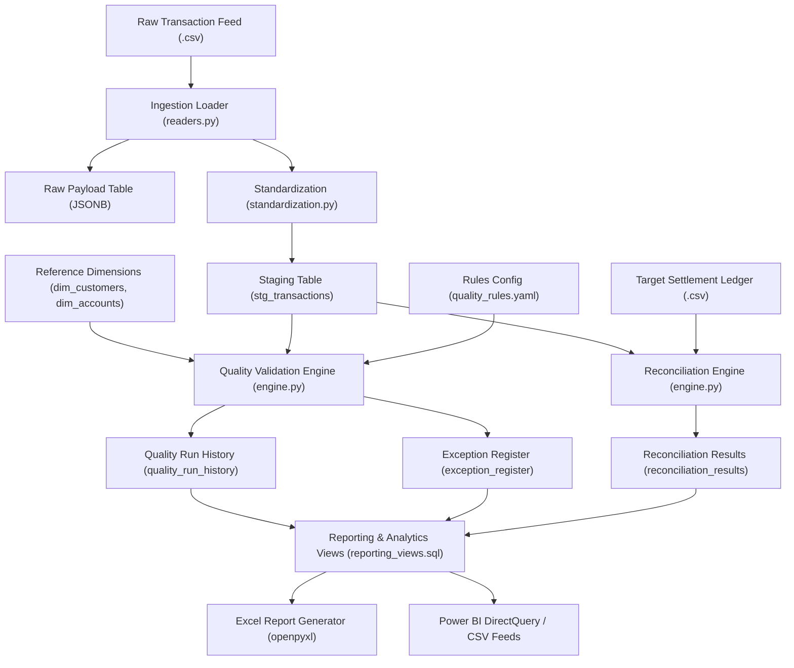

# DataGuard | System Architecture & Technical Design

## 1. Executive Summary

DataGuard is an end-to-end financial data quality and transaction monitoring platform designed to detect, isolate, score, and reconcile transactional data anomalies prior to downstream financial reporting or ledger posting.

The architecture emphasizes **immutability of raw records**, **traceable auditability of exceptions**, **mathematical transparency of quality metrics**, and **strict idempotency of pipeline executions**.

---

## 2. End-to-End Data Flow



---

## 3. Core Architectural Principles

### 3.1 Raw Data Preservation (Non-Destructive Ingestion)
Raw transactional payloads are preserved verbatim in `raw_transactions` as PostgreSQL `JSONB` alongside source record IDs and batch identifiers. Cleaning and standardization occur strictly in the staging layer (`stg_transactions`). If a transaction contains an unparseable monetary string (e.g. `$1,450.8945`), the raw string is retained in the raw table and in staging metadata so analysts can inspect the original anomaly.

### 3.2 Idempotency and Deduplication Strategy
To guarantee that batch reprocessing never duplicates records or corrupts downstream reports:
1. Each source record generates a deterministic SHA-256 fingerprint (`record_hash`) derived from its normalized fields.
2. The staging repository executes a targeted batch partition delete (`DELETE FROM stg_transactions WHERE batch_id = :batch_id`) within the same database transaction before inserting incoming records.
3. Rerunning the exact same batch replaces records deterministically without volume inflation.

### 3.3 Relational Schema and Exact Numeric Types
Floating-point arithmetic (`FLOAT`, `DOUBLE PRECISION`) introduces binary rounding errors unacceptable in financial ledger operations. DataGuard mandates PostgreSQL `NUMERIC(18, 4)` and Python `Decimal` across all monetary fields, tolerances, and signed difference calculations.

---

## 4. Database Layer Architecture

The database model consists of 11 core tables and 6 analytical reporting views:

1. `ingestion_batches`: Batch status, record volume, error tracking.
2. `raw_transactions`: JSONB raw payload preservation.
3. `dim_customers`: Customer KYC status, entity type, country.
4. `dim_accounts`: Account master data, allowed currencies, status.
5. `stg_transactions`: Standardized transactions with exact decimal amounts.
6. `quality_rules`: Active rule definitions, dimensions, default severities.
7. `quality_run_history`: Run metrics, execution timings, composite scores.
8. `exception_register`: Detailed anomaly log linked to rules and records.
9. `exception_resolution_history`: Status lifecycle audit trail (`OPEN` → `UNDER_REVIEW` → `RESOLVED`).
10. `target_ledger_transactions`: External settlement ledger records.
11. `reconciliation_results`: Record-level and aggregate match variances.

---

## 5. Exception Management Lifecycle

Every detected anomaly enters an explicit, auditable workflow:

```
[Anomaly Detected] ──► OPEN ──► UNDER_REVIEW ──► RESOLVED / FALSE_POSITIVE
                         │            │
                         └────────────┴──► History logged in exception_resolution_history
```

- Exceptions are never deleted; resolution modifies `resolution_status`, `resolved_at`, and `resolution_notes`.
- Underlying transaction records in staging are never altered during resolution.
